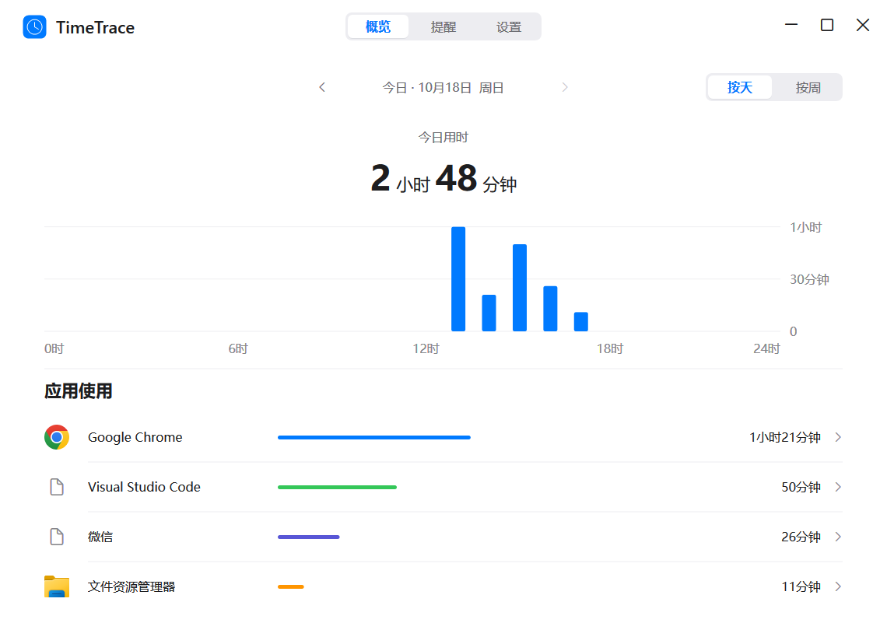

# TimeTrace

TimeTrace 是一个轻量、完全离线的 Windows 11 x64 屏幕时间应用。使用原生窗口、系统字体和 SQLite；无需额外安装运行库。只保存前台应用及使用时段，不采集窗口标题、网页地址、按键内容或截图。

[下载最新版](https://github.com/Aix707/TimeTrace/releases/latest) · [测试报告](docs/TEST-REPORT.md) · [MIT 许可](LICENSE.txt)



1.2.0 优化后台提醒判断、批量写入、查询队列与图标缓存，关闭窗口时释放视图资源。保留简洁界面与现有基础功能。界面规范见 `docs/DESIGN.md`。

## 安装与使用

从 [Releases](https://github.com/Aix707/TimeTrace/releases/latest) 下载 `TimeTrace-1.2.0-Setup.exe` 按用户安装，或下载 `TimeTrace.exe` 直接运行。离线安装包约 0.60 MB，主程序约 1.13 MB，支持 Windows 11 x64。源码包与 SHA-256 校验文件同页提供。

安装默认不开机启动。升级时选择原安装目录，无需先卸载；首次运行自动升级至 schema 4，保留使用记录、名称、分组和提醒配置，移除旧限额兼容表。升级前建议退出旧版并备份数据目录。

- 使用概览：查看当天、本周及历史使用趋势，点击应用查看详情。
- 提醒：同一页提供休息提醒和应用提醒。休息提醒默认关闭，预设 60 分钟；应用提醒可添加、修改、删除。两者时长均为 1—1440 分钟。
- 休息提醒：跨应用连续使用设备满指定间隔后提醒；桌面上的有效操作也计入。每满间隔再次提醒。
- 应用提醒：指定应用当天累计满指定时长后提醒一次。提醒状态始终对应今天，不跟随历史日期或周视图切换。
- 通知按钮：再使用 5 分钟后提醒，按该设备或应用的实际使用时间计算；今日不再提醒，只静默当前一项，次日恢复。点击按钮后继续托盘运行，点击正文打开提醒页。系统通知不可用时尝试托盘气泡，也可在页内执行延后和静默。
- 应用详情：保留重命名与合并。合并优先保留目标应用的提醒，目标未配置时继承来源设置，保留静默和剩余延后时间。原始记录保持不变。
- 托盘：打开窗口、暂停／恢复统计、退出。关闭窗口继续统计并释放绘图资源。
- 设置：开机启动默认关闭；清除历史需确认，保留名称、分组和提醒配置，同时重置计时及提醒状态。

## 计时口径

只将 Windows 当前前台窗口归属为聚焦应用；鼠标悬停不改变对象，多显示器同时仅统计一个。连续无键鼠操作满 5 分钟后暂停，前 5 分钟仍计入。空闲、锁屏、睡眠或手动暂停会结束本轮设备连续使用，恢复后从零开始；应用当天累计保留。跨午夜仅重置应用当天累计，设备连续使用不重置。

重新启动不补算未采集时间，设备开始新一轮；应用当天累计、已提醒、延后及今日静默从本机恢复。设备今日静默也保留，但上轮设备通知动作随会话结束失效。实际修改配置后重新判断；保存相同配置不会重复触发。

数据位于 `%LOCALAPPDATA%\TimeTrace\data.db`，使用 SQLite WAL 和事务。每秒检查活动状态，每 5 秒批量保存；发送通知前原子保存用时和提醒状态。异常终止通常最多损失最近约 5 秒，正常退出保存剩余记录。使用本地日期，每周从周一开始。卸载保留个人记录。

Windows 勿扰和通知设置可能影响横幅与气泡显示；页内仍保留提醒状态。第一版只提供温和提醒，不强制拦截应用，不做网站细分或云同步。

## 构建与验证

需要 Visual Studio 2022 C++ Build Tools、Windows SDK、CMake；离线安装器使用便携 NSIS。SQLite 源码随仓库提供，应用运行库静态链接。

```powershell
.\scripts\Build.ps1 -Package
```

核心自动检查与隔离注册检查在构建中执行。更多验证入口：

```powershell
# 包含通知动作转交的检查，使用独立临时目录
ctest --test-dir build -C Release --output-on-failure
# 受控前台切换
.\scripts\Verify-Foreground.ps1
# 托盘资源测量（默认预热 120 秒、测量 1800 秒）
.\scripts\Measure-Performance.ps1
```

源码职责及数据升级说明见 `docs/ARCHITECTURE.md`；本版实测、体积和待验收项目见 `docs/TEST-REPORT.md`。安装及卸载检查脚本会拒绝在已有真实安装的当前用户环境运行。

## 命令行

```text
--background             仅托盘运行
--reminders              打开提醒页
--stop                   保存后退出
--pause / --resume       暂停或恢复统计
--data-dir PATH          使用独立数据目录（测试、便携用途）
--render PATH            将实际绘图保存为 PNG，不开始采集
--page reminders         预览提醒页，可用 overview / detail / settings
--render-width N         预览宽度（920—3840）
--render-height N        预览高度（680—2160）
--date YYYY-MM-DD        预览历史日期
--week                   预览周视图
--app-id ID              预览指定应用详情
```

`timetrace://reminders` 打开提醒页；兼容旧的 `--limits`、`timetrace://limits` 和 `--page limits`。通知动作仅接收严格格式的规则 ID 与本次通知标识，重复、过期、已删除规则的动作会被忽略。

快捷键：Ctrl+1／2／3 切换概览、提醒、设置；Tab 聚焦控件，左右键切换选项，Enter／空格执行，Esc 返回概览。点击概览日期可回到今天。
